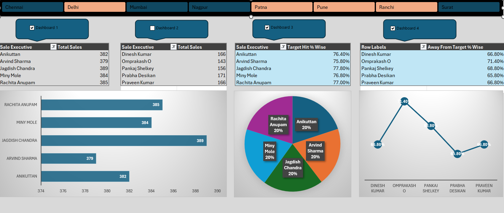

# Excel Sales Analytics Dashboard

## Project Overview

This project is an interactive sales analytics dashboard created using Microsoft Excel. It helps analyze sales performance, compare sales executives, and track target achievement across different regions.

## Dashboard Preview

*Interactive Excel dashboard showing regional filtering, sales performance, target achievement, and performance charts.*

## Key Features

- **Region Slicer:** Filter sales data by region.
- **Dashboard Selection:** Four checkboxes to control slicer connections across dashboards.
- **Sales Analysis:** Compare total sales by sales executive.
- **Target Achievement:** Analyze target hit percentages.
- **Performance Charts:** Visualize sales using bar, pie, and line charts.
- **VBA Automation:** Automate slicer connections between PivotTables.

## Tools Used

- Microsoft Excel
- PivotTables
- PivotCharts
- Slicers
- Excel VBA

## How to Use

1. Download `End to End Project using Excel.xlsm` from this repository.
2. Open the workbook in Microsoft Excel desktop.
3. Enable macros only if you trust the workbook and its source.
4. Use the Region slicer to filter the data.
5. Select the dashboard checkboxes to control slicer connections.
6. Review the tables and charts to explore sales performance.

## Skills Demonstrated

- Data analysis using Excel
- Interactive dashboard development
- Data visualization
- PivotTable and slicer management
- VBA automation

## Project File

**Excel workbook:** `End to End Project using Excel.xlsm`

## Author

Excel Data Analytics Portfolio Project
